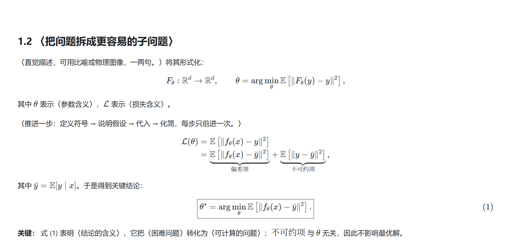

# tutorial-writing-skill

把「数学／技术推导讲义」的写法固化为可复用的 **VS Code Copilot 技能（Agent Skill）**：文档结构、公式排版、表达方式、迭代与交付约定。

目标读者是**有基础但没学过这个主题的人**（例如刚进课题组的研究生）。写作标准是：读者只靠这一篇文档，就能独立复现每一步推导与实现。

## 三条优先级（其余都是手段）

1. **公式必须写对** —— 符号先定义后使用且全程不换名；每步只做一处变换并写出依据；检查边界与退化情形；能数值验证的结论就真的验证一次。
2. **推导必须简洁易懂** —— 一次只前进一步；先给直觉再形式化；砍掉不服务于主线的分支；每个公式后紧跟一句人话。
3. **名词必须串联成一条线** —— 每个新名词都交代「解决上一节什么问题 + 它是什么 + 与已有名词的关系」；每个结论都能回答「为了解决什么，得到了什么」。

骨架、疑问式标题、`\boxed{}`、编号、检查清单都只是达成这三条的手段。内容与模板冲突时，听内容——不要为了填满模板而写文档。

## 其他约定

| 方面 | 规定 |
| --- | --- |
| 文档骨架 | frontmatter → `> **核心问题：**` → 导语 → 阅读路线 → 参考文献 → 分步章节 → 总结（默认起点，可裁剪） |
| 结论句式 | 每节收尾能塞进「为了解决〈上一节的不足〉，我们得到〈本节的结论〉」 |
| 公式规范 | 只用 KaTeX ∩ MathJax 安全子集；多行用 `aligned`／`cases`；编号用 `\tag{}` |
| 实现配套 | 给出与公式一一对应的最小可运行代码，变量名与符号名一致 |
| 交付方式 | **Markdown 是唯一源文件**；PDF／HTML 只是可选、可再生的最后一步 |

## 安装

技能目录名必须与 `SKILL.md` 里 frontmatter 的 `name` 一致（本仓库为 `tutorial-writing-skill`），否则技能会静默加载失败。

```bash
# 个人级（所有项目可用）
git clone https://github.com/zcxAcSg/tutorial-writing-skill ~/.copilot/skills/tutorial-writing-skill

# 或项目级（随仓库共享给团队）
git clone https://github.com/zcxAcSg/tutorial-writing-skill <项目>/.github/skills/tutorial-writing-skill
```

VS Code 支持的技能目录：工作区 `.github/skills/`、`.claude/skills/`、`.agents/skills/`；个人 `~/.copilot/skills/`、`~/.claude/skills/`、`~/.agents/skills/`。

## 使用

在 Copilot Chat 中提出写作任务即可（技能会在相关时自动加载），例如：

- 「用 tutorial-writing-skill 写一篇 `XX` 的详细推导讲义」
- 「把这份草稿按讲义规范重排结构，补上动机与总结」
- 「检查这篇文档是否符合讲义规范：结构、公式排版、总结」

## 仓库结构

```
SKILL.md                          技能主文件：风格信条、文档骨架、写作流程、检查清单、反模式
examples/
  skeleton-template.md            可直接复制的空骨架（占位符用 〈…〉 标注）
  screenshots/
    01-document-structure.png     骨架渲染效果：元信息、核心问题、阅读路线、章节开头
    02-math-layout.png            骨架渲染效果：多行推导、框选结论、编号公式、对照表
reference/
  math-and-markdown.md            公式与排版细则、KaTeX 实测矩阵、渲染自检方法
scripts/
  verify-math.mjs                 公式渲染校验器（提交前／CI 均可运行）
```

## 公式校验脚本

`scripts/verify-math.mjs` 会检查每个公式能否被 KaTeX（VS Code 预览的渲染器）渲染，并抓出常见跨平台问题：公式内裸中文、`$$` 内用裸 `\\` 换行、LaTeX 定界符 `\(…\)`、以及 `\newcommand`／`\ce`／`\SI`／`\href` 这类不稳定或不可用的宏。

```bash
npm install          # 只装一个 devDependency：katex
npm run verify       # 等价于 node scripts/verify-math.mjs .
node scripts/verify-math.mjs 某篇讲义.md   # 也可以只查单个文件
```

有错误时退出码为 1，可直接接进 CI 或提交前钩子。

## 渲染效果




截图由骨架模板本身渲染得到（KaTeX，1.5x 缩放），因此展示的就是实际排版效果。

## 许可

[MIT](LICENSE)
